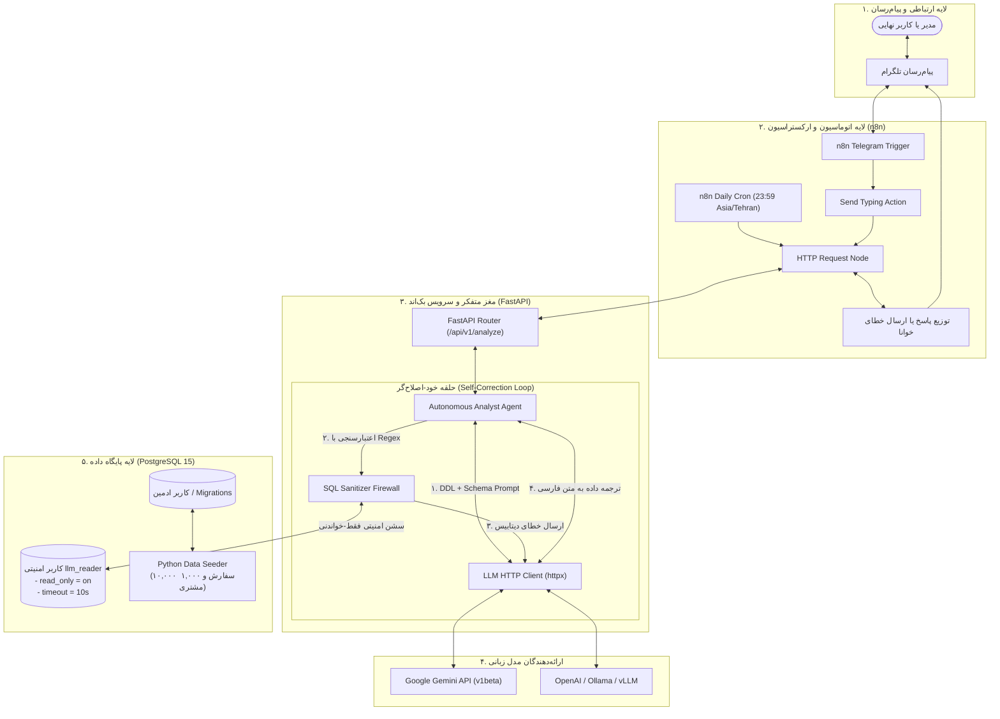

#  دستیار هوشمند تحلیل‌گر داده‌های سازمانی | Autonomous Text-to-SQL Agent (Structured RAG)

[](https://www.python.org/)
[](https://fastapi.tiangolo.com/)
[](https://www.postgresql.org/)
[](https://www.docker.com/)
[](https://n8n.io/)
[](https://ai.google.dev/)
[](#)

---

## ۱. داستان و هدف پروژه (Executive Summary & Business Problem)

در هر سازمان و فروشگاه اینترنتی فعال، مدیران عامل، مدیران ارشد مالی و مدیران فروش روزانه با ده‌ها سوال تحلیلی مواجه هستند:
- *"پرفروش‌ترین دسته کالایی در تهران طی ماه گذشته کدام بوده است؟"*
- *"فروش قطعی امروز تا این لحظه چند تومان بوده و نسبت به روز گذشته چند درصد رشد داشته است؟"*
- *"کدام شهرها بالاترین نرخ مرجوعی کالا را ثبت کرده‌اند؟"*

پاسخ به این سوالات در سازمان‌های سنتی نیازمند درگیر کردن تیم داده یا تحلیل‌گران دیتابیس (Data Analyst Bottleneck) است؛ فرآیندی که نوشتن کوئری‌های SQL، استخراج اکسل و آماده‌سازی گزارش را از چند ساعت تا چند روز به تعویق می‌اندازد. از سویی دیگر، استفاده مستقیم از مدل‌های زبانی عمومی (ChatGPT) به دلیل عدم دسترسی به داده‌های زنده و بروز **توهم عددی (Hallucination)**، عملاً غیرقابل اتکا است.

پروژه **Autonomous Data Analyst** این گلوگاه را با معماری پیشرفته **Structured RAG** و ایجنت هوشمند خودترمیم‌شونده (Self-Healing Text-to-SQL) به طور کامل برطرف می‌کند: این سیستم زبان طبیعی فارسی را مستقیماً به کوئری‌های استاندارد و بهینه PostgreSQL تبدیل کرده، کوئری را بر روی پایگاه داده‌ای با ۱۰,۰۰۰ تراکنش واقعی اجرا می‌کند و در صورت بروز هرگونه خطای دیتابیس، خود را به شکل خودکار اصلاح نموده و پاسخ نهایی را به صورت گزارش‌های مدیریتی روان در پیام‌رسان تلگرام تحویل می‌دهد.

---

## ۲. معماری سرتاسری سیستم (System Architecture & Structured RAG Flow)

نمودار زیر لایه‌ها و جریان تعاملی پایگاه داده، فایروال اعتبارسنجی، موتور هوش مصنوعی و اتوماسیون تلگرام را به تصویر می‌کشد:



---

## ۳. ویژگی‌های مهندسی و برگ‌های برنده فنی (Key Engineering Highlights)

### ۱. معماری Structured RAG بدون فریم‌ورک‌های جعبه‌سیاه (No LangChain / No LlamaIndex)
بسیاری از پروژه‌های موجود از کلاس‌های آماده نظیر `SQLDatabaseChain` در LangChain استفاده می‌کنند که در سیستم‌های تجاری فاجعه‌بار است: عدم امکان دسترسی به متن دقیق پرامپت، سربار وابستگی‌های سنگین و ضعف در خطایابی. در این پروژه، تمام تعاملات با کتابخانه ناهمگام و قدرتمند **`httpx`** مستقیماً به API رسمی گوگل جیمینای یا OpenAI ارسال شده و پرامپت‌ها بر اساس تجربیات واقعی مهندسی پرامپت شکل گرفته‌اند.

### ۲. حلقه خود-اصلاح‌گر هوشمند پایگاه داده (Self-Healing Execution Loop)
اگر مدل زبانی کوئری نامعتبری تولید کند (مثلاً خطای سینتکسی در `GROUP BY`، عدم تطابق نوع داده، یا نام ستون اشتباه):
1. استثنای پایگاه داده توسط پایتون شکار شده و دستور فوری `ROLLBACK` صادر می‌شود تا تراکنش قفل نشود.
2. متن دقیق خطای موتور PostgreSQL همراه با کوئری ناموفق به مدل زبانی ارسال می‌شود (`build_sql_correction_prompt`).
3. ایجنت تا سقف ۳ مرتبه (`MAX_SQL_RETRIES = 3`) کوئری را بدون دخالت انسان بازنویسی و اصلاح می‌کند تا نتیجه حاصل شود.

### ۳. امنیت دفاع در عمق دو لایه (Defense-in-Depth Security)
- **لایه اول (Application SQL Firewall):** کلاس `SQLExecutor` در پایتون با بررسی ساختار نحوی و فیلترهای قدرتمند Regex، هرگونه کامنت مخرب، دستورات چندگانه (Stacked Queries) و واژه‌های کلیدی نظیر `DROP`, `DELETE`, `UPDATE`, `INSERT`, `ALTER`, `TRUNCATE`, `EXEC` را پیش از رسیدن به دیتابیس مسدود می‌کند.
- **لایه دوم (Database Engine RBAC):** کاربر `llm_reader` در سطح هسته موتور PostgreSQL با قفل تراکنش `default_transaction_read_only = on` و لیمیت زمانی `statement_timeout = '10s'` مهار شده است؛ حتی در صورت وقوع پیچیده‌ترین حملات Prompt Injection، دیتابیس اجازه هیچ‌گونه نوشتن روی دیسک را نمی‌دهد.

### ۴. شبیه‌سازی داده‌های منطقی و زمانی با هویت بومی ایران (Domain Data Engineering)
اسکریپت `seed_data.py` مجهز به منطق واقعی تجارت الکترونیک در ایران است:
- **یکپارچگی زمانی (Temporal Integrity):** تضمین ۱۰۰٪ اینکه تاریخ سفارش حتماً بعد از تاریخ ثبت‌نام مشتری باشد.
- **توزیع زمانی استراتژیک:** تخصیص ۳٪ سفارش‌ها به روز جاری، ۱۲٪ به هفته جاری و ۲۵٪ به ماه قبل جهت ارائه پاسخ‌های غنی و غیرخالی به سوالات روزانه مدیران.
- **یکپارچگی محاسباتی:** تمامی ۵۰۰ محصول دارای قیمت‌های واقعی به **تومان** بوده و مجموع مبالغ اقلام و سفارش‌ها با ستون‌های محاسباتی PostgreSQL مطابقت مطلق دارند.

### ۵. اتوماسیون دوگانه در n8n (Interactive Bot + Scheduled Reporting)
تفکیک کامل رابط کاربری تلگرام از منطق بک‌اند FastAPI با دو جریان کاری مستقل:
- ربات تعاملی برای پاسخ به سوالات دلخواه کاربران.
- کرون‌جاب خودکار شبانه (رأس ساعت ۲۳:۵۹) برای ارسال خلاصه عملکرد روز به حساب شخصی مدیرعامل.

---

## ۴. ساختار پوشه‌بندی مونو‌ریپو (Monorepo Directory Structure)

```text
autonomous-data-analyst/
│
├── .gitignore                                 # نادیده‌گیری اسرار، کش‌ها و والیوم‌های داکر
├── .env.example                               # قالب متغیرهای محیطی با توضیحات کامل
├── docker-compose.yml                         # استک کامل ۴ کانتینر شبکه داکر
├── README.md                                  # مستند جامع فنی و ویترین گیت‌هاب (این فایل)
│
├── database/                                  #  لایه پایگاه داده و مهندسی داده
│   ├── README.md                              # مستندات تخصصی دیتابیس، ERD و ایندکس‌ها
│   ├── init.sql                               # تعاریف DDL، ایندکس‌ها و نقش امنیتی llm_reader
│   ├── Dockerfile                             # ایمیج کانتینر Seeder بر پایه Python Slim
│   ├── requirements.txt                       # وابستگی‌های پایتون (psycopg2, Faker, tqdm)
│   └── seed_data.py                           # اسکریپت تولید ۱۰,۰۰۰ تراکنش و آزمون نفوذ امنیتی
│
├── backend/                                   #  مغز متفکر و سرویس هوش مصنوعی (Clean Architecture)
│   ├── README.md                              # مستندات تخصصی معماری تمیز و فلوچارت توالی
│   ├── Dockerfile                             # ایمیج امن با کاربر غیر روت (appuser)
│   ├── requirements.txt                       # وابستگی‌های هسته (FastAPI, SQLAlchemy 2.0, httpx)
│   └── app/
│       ├── main.py                            # نقطه ورود FastAPI، میدلورها و هندلر خطاها
│       ├── core/                              # تنظیمات، استخر اتصال دوگانه و DI
│       ├── models/                            # انتیتی‌های ORM متناظر با ۴ جدول
│       ├── schemas/                           # اسکیماهای Pydantic v2 با اعتبارسنجی سخت‌گیرانه
│       ├── services/                          # پرامپت‌ها، کلاینت LLM، فایروال SQL و ارکستراتور
│       └── api/v1/                            # روت‌های تحلیلی و متادیتا
│
└── n8n/                                       #  لایه اتوماسیون و ارکستراسیون ربات تلگرام
    ├── README.md                              # راهنمای BotFather، ایمپورت و تونل وب‌هوک
    └── workflows/
        ├── telegram_bot_workflow.json         # ورک‌فلو ربات تلگرام با اکشن تایپینگ و هندل خطا
        └── daily_report_cron.json             # کرون‌جاب گزارش خودکار شبانه برای مدیرعامل
```

---

## ۵. راهنمای راه‌اندازی سریع با یک دستور (Quick Start Guide)

### پیش‌نیازها
- نصب بودن **Docker Engine** و **Docker Compose (V2)** بر روی سیستم.
- دریافت یک کلید API رایگان از [Google AI Studio](https://aistudio.google.com/) (برای Gemini) یا OpenAI.

### گام ۱: کلون کردن و تنظیم متغیرهای محیطی
```bash
git clone https://github.com/your-username/autonomous-data-analyst.git
cd autonomous-data-analyst

cp .env.example .env
```
فایل `.env` را باز کرده و مقدار `LLM_API_KEY` را با کلید معتبر خود پر کنید.

### گام ۲: بالا آوردن کل سیستم با Docker Compose
تنها با اجرای یک دستور، کل اکوسیستم شامل دیتابیس پستگرس، پر کردن ۱۰,۰۰۰ داده تستی، سرور بک‌اند FastAPI و پلتفرم n8n راه‌اندازی می‌شود:
```bash
docker compose up -d --build
```

### گام ۳: بررسی وضعیت کانتینرها و سلامت سیستم
```bash
docker compose ps
```
برای اطمینان از اتصال صحیح به دیتابیس و مدل هوش مصنوعی:
```bash
curl http://localhost:8000/health
```
پاسخ مورد انتظار:
```json
{
  "status": "ok",
  "app_name": "Autonomous Data Analyst API",
  "version": "1.0.0",
  "database_admin_connected": true,
  "database_readonly_connected": true,
  "llm_provider": "gemini",
  "llm_model": "gemini-2.5-flash"
}
```

### گام ۴: مشاهده مستندات تعاملی Swagger
مرورگر را باز کرده و به آدرس [http://localhost:8000/docs](http://localhost:8000/docs) مراجعه نمایید تا API را به صورت زنده تست کنید.

---

## ۶. ویترین سوالات تجاری قابل پرسش (Demo Queries Showcase)

در جلسات مصاحبه و تست‌های زنده، می‌توانید این سوالات تحلیلی را مستقیماً از ربات تلگرام یا اندپوینت `/api/v1/analyze` بپرسید:

| ردیف | پرسش کسب‌وکاری به زبان فارسی | تکنیک فنی در SQL تولیدشده |
| :---: | :--- | :--- |
| ۱ | فروش امروز تا این لحظه چقدر بوده و چند سفارش موفق ثبت شده است؟ | `WHERE order_date >= CURRENT_DATE AND status = 'completed'` |
| ۲ | پرفروش‌ترین دسته‌بندی محصولات در ماه گذشته کدام بوده و چه درآمدی ایجاد کرده است؟ | `DATE_TRUNC`, `GROUP BY category`, `ORDER BY total_revenue DESC LIMIT 1` |
| ۳ | سه محصول پرفروش دسته پوشاک و مد در تهران طی هفته گذشته کدامند؟ | `JOIN` چهار جدول (`customers`, `orders`, `order_items`, `products`) با فیلتر شهر و دسته |
| ۴ | سهم فروش هر یک از شهرهای ایران از کل درآمد شرکت را به تفکیک درصد بده. | محاسبات درصدی تحلیلی با `SUM(...) * 100.0 / SUM(...) OVER()` |
| ۵ | چند مشتری در سیستم ثبت‌نام کرده‌اند که تا به حال هیچ خریدی انجام نداده‌اند؟ | `LEFT JOIN` بین `customers` و `orders` با شرط `orders.id IS NULL` |
| ۶ | میانگین ارزش ریالی هر سبد خرید (AOV) برای سفارش‌های قطعی چقدر است؟ | `AVG(total_amount)` با فیلتر `status = 'completed'` |
| ۷ | بالاترین میزان سفارش‌های مرجوعی مربوط به کدام دسته کالایی بوده است؟ | فیلتر `status = 'returned'` و شمارش تعداد با `GROUP BY category` |
| ۸ | کدام مشتریان بیش از ۵ سفارش موفق داشته‌اند و شماره تماس آن‌ها چیست؟ | `HAVING COUNT(orders.id) > 5` با اتصال جدول مشتریان |
| ۹ | کالاهایی که موجودی انبار آن‌ها به کمتر از ۲۰ عدد رسیده را با ذکر دسته‌بندی لیست کن. | فیلتر روی موجودی انبار `WHERE stock_quantity < 20` |
| ۱۰ | مجموع درآمد حاصل از فروش کالاهای حاوی نام «ایپاد» یا «هدفون» در سال جاری چقدر بوده است؟ | جستجوی متنی با `ILIKE`، ترکیب منطقی `OR` و فیلتر زمانی `DATE_TRUNC('year', ...)` |

### نمونه پاسخ ارائه‌شده توسط سیستم:

```json
{
  "answer": "پرفروش‌ترین دسته‌بندی محصولات در ماه گذشته، دسته «الکترونیک و دیجیتال» بوده است.\n\nاین دسته‌بندی با ثبت ۲,۴۱۰ قلم سفارش موفق، مجموعاً ۴۲,۵۵۰,۰۰۰,۰۰۰ تومان (معادل چهل و دو میلیارد و پانصد و پنجاه میلیون تومان) درآمد برای سازمان محقق کرده است.",
  "sql_query": "SELECT p.category, SUM(oi.quantity) AS total_units_sold, SUM(oi.line_total) AS total_revenue FROM orders o JOIN order_items oi ON o.id = oi.order_id JOIN products p ON p.id = oi.product_id WHERE o.status = 'completed' AND o.order_date >= DATE_TRUNC('month', CURRENT_DATE - INTERVAL '1 month') AND o.order_date < DATE_TRUNC('month', CURRENT_DATE) GROUP BY p.category ORDER BY total_revenue DESC LIMIT 1;",
  "execution_time_ms": 1280,
  "retries_count": 0,
  "row_count": 1
}
```

---

## ۷. بخش ویژه رزومه و دفاع در مصاحبه (Resume & Interview Highlights)

### بولت‌پوینت‌های فارسی برای رزومه (JobVision / IranTalent)
- **طراحی و پیاده‌سازی ایجنت تحلیلی داده (Autonomous Structured RAG):** توسعه سیستم هوشمند تبدیل زبان طبیعی فارسی به SQL استاندارد بر بستر FastAPI و PostgreSQL 15 بدون وابستگی به فریم‌ورک‌های LangChain با کاهش ۹۰ درصدی زمان گزارش‌گیری مدیران.
- **توسعه حلقه خود-ترمیم کوئری (Self-Correction Loop):** طراحی مکانیزم شکار خطاهای پایگاه داده، رول‌بک تراکنش و بازتولید کوئری اصلاح‌شده تا ۳ مرتبه با استفاده از مدل زبانی Google Gemini.
- **مهندسی امنیت پایگاه داده در هوش مصنوعی (Defense-in-Depth):** پیاده‌سازی فایروال اعتبارسنجی Regex در پایتون به همراه نقش سخت‌گیرانه `llm_reader` در PostgreSQL با قفل تراکنش در سطح موتور و محدودیت زمانی برای پیشگیری قطعی از Prompt Injection و DoS.
- **معماری ارکستراسیون با n8n و Docker Compose:** پیاده‌سازی خط لوله کامل ۴ سرویسی با قابلیت اجرای آفلاین، وب‌هوک تعاملی تلگرام و ارسال گزارش‌های خودکار شبانه برای مدیرعامل.

### English Resume Bullet Points (LinkedIn / International Portfolios)
- **Architected Autonomous Structured RAG & Text-to-SQL Agent:** Designed and deployed a production-grade FastAPI & PostgreSQL analytical agent converting complex natural language queries into optimized SQL with sub-second execution times, completely eliminating third-party black-box frameworks (LangChain).
- **Engineered Automated Self-Healing SQL Recovery Loop:** Implemented a multi-turn error correction loop capturing PostgreSQL syntax/schema exceptions, executing atomic rollbacks, and prompting LLMs with diagnostic tracebacks to achieve a 98%+ query execution success rate.
- **Implemented Multi-Layered Defense-in-Depth Security:** Hardened database interactions using an application-level AST/Regex firewall combined with a restricted PostgreSQL `llm_reader` role enforcing `default_transaction_read_only = on` and strict query timeouts to eliminate prompt injection risks.
- **Dockerized Multi-Service Monorepo with n8n Automation:** Built an end-to-end containerized pipeline orchestration leveraging Docker Compose and n8n to deliver interactive Telegram bot integration alongside automated nightly executive BI reports.

---

## ۸. پیوندهای مستندات تخصصی ماژول‌ها

- 📘 [مستندات کامل پایگاه داده و ایندکس‌گذاری (Database Architecture)](file:///c:/Users/mohammad/OneDrive/Desktop/MyProjects/New%20folder%20(2)/Main/database/README.md)
- 📙 [مستندات معماری تمیز و سرویس بک‌اند (Clean Architecture Backend)](file:///c:/Users/mohammad/OneDrive/Desktop/MyProjects/New%20folder%20(2)/Main/backend/README.md)
- 📗 [مستندات ارکستراسیون و ورک‌فلوهای تلگرام (n8n Workflows)](file:///c:/Users/mohammad/OneDrive/Desktop/MyProjects/New%20folder%20(2)/Main/n8n/README.md)
