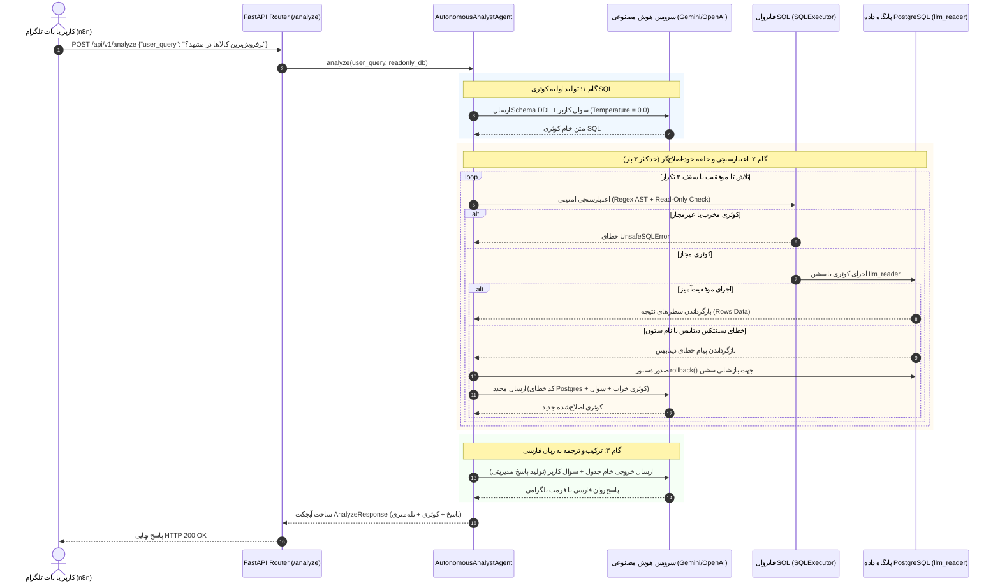

# معماری سرویس بک‌اند و ایجنت خودترمیم‌شونده (Backend & Self-Healing AI Agent)

این ماژول، مغز متفکر و لایه محاسباتی سیستم **Autonomous Data Analyst** است. این سرویس بر پایه **FastAPI**, **SQLAlchemy 2.0**, **Pydantic v2** و فراخوانی مستقیم API مدل‌های زبانی (بدون فریم‌ورک‌های جعبه‌سیاه نظیر LangChain یا LlamaIndex) با رعایت اصول **معماری تمیز (Clean Architecture)** توسعه یافته است.

---

## ۱. معماری تمیز (Clean Architecture) در لایه بک‌اند

ساختار بک‌اند بر اساس تفکیک دقیق مسئولیت‌ها (Separation of Concerns) به ۵ لایه اصلی تقسیم شده است:

```text
backend/app/
├── core/         # تنظیمات متمرکز (Settings)، موتورهای دیتابیس و تزریق وابستگی
├── models/       # انتیتی‌های ORM متناظر با جداول پایگاه داده در SQLAlchemy 2.0
├── schemas/      # قراردادهای ورودی/خروجی و اعتبارسنجی با Pydantic v2
├── services/     # منطق دامنه: ساخت پرامپت‌ها، کلاینت HTTP هوش مصنوعی، فایروال SQL و ارکستراتور ایجنت
└── api/v1/       # روت‌ها و اندپوینت‌های RESTful
```

### مزایای معماری تمیز در سیستم‌های AI:
- **تست‌پذیری مستقل (Testability):** می‌توان منطق ایجنت (`agent_service.py`) یا فایروال SQL (`sql_executor.py`) را به سادگی و بدون نیاز به راه‌اندازی سرور وب تست کرد.
- **تغییرپذیری ارائه‌دهنده هوش مصنوعی:** با یک متغیر محیطی (`LLM_PROVIDER=gemini` یا `LLM_PROVIDER=openai`) می‌توان بین Google Gemini، OpenAI، یا سرورهای محلی نظیر Ollama و vLLM جابه‌جا شد.
- **ایزولاسیون خطا (Fault Isolation):** خطاهای پایگاه داده، خطاهای تایم‌اوت هوش مصنوعی و خطاهای فایروال به صورت مستقل مدیریت می‌شوند.

---

## ۲. دیاگرام توالی جریان کاری و حلقه خود-اصلاح‌گر (Self-Correction Sequence Diagram)

نمودار زیر تعاملات گام‌به‌گام بین کاربر/ربات تلگرام، روت‌های FastAPI، مغز ایجنت، مدل زبانی، فایروال اعتبارسنجی و موتور PostgreSQL را به تصویر می‌کشد:



---

## ۳. تزریق وابستگی و استخر کانکشن‌های دوگانه (Dual Engine Pools)

در طراحی این سیستم، از دو موتور اتصال کاملاً مجزا در SQLAlchemy 2.0 استفاده شده است:

1. **موتور ادمین (`admin_engine`):**
   - برای وظایف نگهداری و بررسی سلامت سرور (`check_database_health`).
   - متصل به کاربر سوپریوزر با اندازه استخر ۵ کانکشن.
2. **موتور امنیتی هوش مصنوعی (`readonly_engine`):**
   - منحصراً در اختیار ایجنت تحلیلی.
   - متصل به کاربر محدودشده `llm_reader` با اندازه استخر ۱۰ کانکشن.
   - اعمال تنظیمات قفل تراکنش در سطح کانکشن درایور:
     ```python
     connect_args={
         "options": "-c default_transaction_read_only=on -c statement_timeout=10000 -c timezone=Asia/Tehran"
     }
     ```

### چرا از `yield` در Dependency Injection استفاده شده است؟
در FastAPI، استفاده از ژنراتورهای `yield` تضمین می‌کند که سشن پایگاه داده در بلوک `finally:` قرار گرفته و به محض اتمام پردازش درخواست HTTP بسته شود. این کار از قفل شدن کانکشن‌ها (Connection Pool Exhaustion) در ترافیک بالا جلوگیری می‌کند:
```python
def get_readonly_db() -> Generator[Session, None, None]:
    db = ReadOnlySessionLocal()
    try:
        yield db
    finally:
        db.rollback()  # پاکسازی هرگونه تراکنش معلق
        db.close()     # بازگرداندن کانکشن به استخر
```

---

## ۴. کالبدشکافی مغز متفکر (Prompt Engineering & Self-Healing Loop)

### الف) تزریق معنایی ساختار (Semantic Schema Injection)
در فایل `prompts.py`، علاوه بر ساختار DDL جداول، یک **فرهنگ واژگان دامنه (Domain Value Dictionary)** به مدل تزریق می‌شود. این متدولوژی خطای مدل زبانی را به صفر می‌رساند:
- مقادیر دقیق وضعیت سفارش‌ها (`completed` برای فروش قطعی، `processing`, `cancelled`, `returned`).
- اسامی دقیق دسته‌بندی‌های پنج‌گانه بازار کالا به زبان فارسی (مثلاً `'الکترونیک و دیجیتال'`).
- اسامی دقیق ۱۱ کلان‌شهر ایران.
- الزام به استفاده از عملگر `ILIKE` برای جستجوی نام کالاها.
- تبدیل صحیح مفاهیم زمانی با توابع بومی PostgreSQL (`DATE_TRUNC`, `CURRENT_DATE`, `INTERVAL`).

### ب) سازوکار حلقه خود-ترمیم (Self-Healing Execution Loop)
هنگامی که کوئری تولیدشده به هر دلیلی در دیتابیس دچار خطا شود (مثلاً فراموش کردن یک ستون در `GROUP BY` یا استفاده از نام ستون نامعتبر):
1. استثنای `SQLAlchemyError` توسط کلاس `SQLExecutor` گرفته می‌شود.
2. دستور `db.rollback()` به صورت فوری صادر می‌شود تا دیتابیس از وضعیت `InFailedSqlTransaction` خارج شود.
3. پرامپت اصلاح خودکار (`build_sql_correction_prompt`) ساخته شده و خطای دقیق PostgreSQL در کنار کوئری شکست‌خورده به مدل فرستاده می‌شود.
4. مدل خطای خود را تحلیل کرده و نسخه اصلاح‌شده را بازمی‌گرداند. این فرآیند تا سقف `MAX_SQL_RETRIES = 3` ادامه می‌یابد.

### ج) چرا LangChain حذف شد؟
استفاده از LangChain در پروژه‌های Enterprise اغلب با چالش‌های بزرگی نظیر:
- پنهان‌سازی جزئیات پرامپت‌ها و عدم امکان دیباگ دقیق.
- سربار حافظه و وابستگی‌های سنگین غیرضروری.
- شکنندگی زنجیره‌های از پیش‌آماده (SQLDatabaseChain).
- ناسازگاری با زبان فارسی و فرمت‌های محلی.

در این سیستم، با پیاده‌سازی مستقل کلاینت HTTP با لایبرری قدرتمند `httpx`، سیستم ۱۰۰٪ قابل ردیابی و بدون کوچک‌ترین سربار اضافه اجرا می‌شود.

---

## ۵. لایه امنیتی مضاعف پایتون (Application-Layer SQL Firewall)

با وجود اینکه کاربر `llm_reader` در سطح دیتابیس قفل شده است، رعایت اصل دفاع در عمق (Defense in Depth) حکم می‌کند که کد پایتون نیز ورودی‌های غیرمجاز را مسدود نماید:
- **حذف کامنت‌های SQL:** جلوگیری از تکنیک‌های Comment-Injection.
- **تک‌دستوری بودن:** رد دستورات چندگانه با بررسی علامت سمیکالن (Stacked Queries).
- **اعتبارسنجی با کلیدواژه مجاز:** کوئری حتماً باید با `SELECT` یا `WITH` شروع شود.
- **فیلتر کلیدواژه‌های مخرب با Regex:** هرگونه واژه شامل `DROP`, `DELETE`, `UPDATE`, `INSERT`, `ALTER`, `TRUNCATE`, `EXEC`, `PG_SLEEP` فوراً استثنای `UnsafeSQLError` ایجاد کرده و درخواست متوقف می‌شود.

---

## ۶. مستندات اندپوینت‌ها و نمونه تست

### ۱. تحلیل سوال با هوش مصنوعی (`POST /api/v1/analyze`)

#### نمونه فراخوانی با cURL:
```bash
curl -X POST "http://localhost:8000/api/v1/analyze" \
     -H "Content-Type: application/json" \
     -d '{
       "user_query": "سه محصول پرفروش دسته پوشاک و مد در تهران طی ماه گذشته کدامند؟"
     }'
```

#### نمونه پاسخ JSON:
```json
{
  "answer": "سه محصول پرفروش در دسته «پوشاک و مد» برای شهروندان تهرانی در ماه گذشته عبارتند از:\n\n۱. **کفش ورزشی نایکی پیاده‌روی و رانینگ مدل پرو کد ۱۰۱**: مجموع فروش ۱۸,۵۰۰,۰۰۰ تومان (۴ عدد)\n۲. **کاپشن مردانه ضدآب کلاه‌دار گرم سری پلاس ارتقا یافته**: مجموع فروش ۱۴,۲۰۰,۰۰۰ تومان (۲ عدد)\n۳. **شلوار جین راسته سرمه‌ای ترک مدل اولترا پریمیوم**: مجموع فروش ۷,۸۰۰,۰۰۰ تومان (۳ عدد)\n\nمجموع درآمد حاصل از این ۳ محصول ۴۰,۵۰۰,۰۰۰ تومان بوده است.",
  "sql_query": "SELECT p.name AS product_name, SUM(oi.quantity) AS total_units_sold, SUM(oi.line_total) AS total_revenue FROM orders o JOIN customers c ON c.id = o.customer_id JOIN order_items oi ON oi.order_id = o.id JOIN products p ON p.id = oi.product_id WHERE o.status = 'completed' AND c.city = 'تهران' AND p.category = 'پوشاک و مد' AND o.order_date >= DATE_TRUNC('month', CURRENT_DATE - INTERVAL '1 month') AND o.order_date < DATE_TRUNC('month', CURRENT_DATE) GROUP BY p.name ORDER BY total_revenue DESC LIMIT 3;",
  "execution_time_ms": 1380,
  "retries_count": 0,
  "row_count": 3,
  "raw_data_preview": [
    {
      "product_name": "کفش ورزشی نایکی پیاده‌روی و رانینگ مدل پرو کد ۱۰۱",
      "total_units_sold": 4,
      "total_revenue": 18500000.0
    },
    {
      "product_name": "کاپشن مردانه ضدآب کلاه‌دار گرم سری پلاس ارتقا یافته",
      "total_units_sold": 2,
      "total_revenue": 14200000.0
    },
    {
      "product_name": "شلوار جین راسته سرمه‌ای ترک مدل اولترا پریمیوم",
      "total_units_sold": 3,
      "total_revenue": 7800000.0
    }
  ],
  "correction_history": []
}
```

### ۲. پایش سلامت سیستم (`GET /health`)
```bash
curl -X GET "http://localhost:8000/health"
```
```json
{
  "status": "ok",
  "app_name": "Autonomous Data Analyst API",
  "version": "1.0.0",
  "database_admin_connected": true,
  "database_readonly_connected": true,
  "llm_provider": "gemini",
  "llm_model": "gemini-2.5-flash"
}
```

### ۳. بررسی متادیتای پایگاه داده (`GET /api/v1/schema`)
```bash
curl -X GET "http://localhost:8000/api/v1/schema"
```
این اندپوینت ساختار فعال DDL جداول و لیست مقادیر مجاز دسته‌بندی‌ها و شهرها را بازمی‌گرداند.
