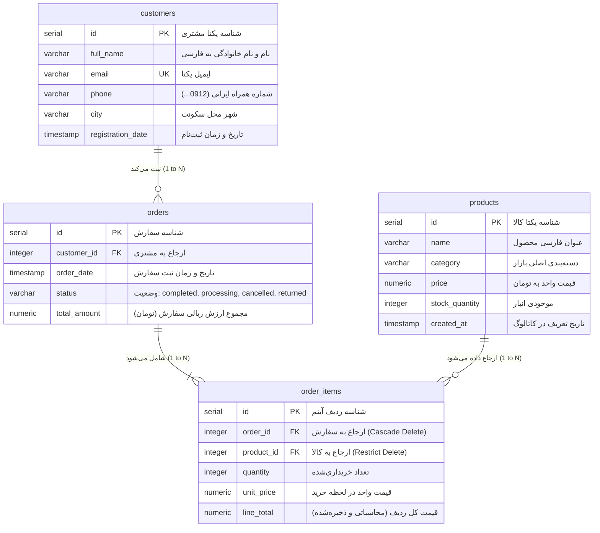

# پایگاه داده تحلیلی و زیرساخت امنیتی (Data Engineering & Security Architecture)

این ماژول، سنگ‌بنا و لایه پایگاه داده پروژه **Autonomous Data Analyst** (سیستم Structured RAG و ایجنت خودترمیم‌شونده Text-to-SQL) است. این لایه یک پایگاه داده رابطه‌ای سازمانی برای یک پلتفرم فروشگاه اینترنتی ایرانی در مقیاس بزرگ را بر بستر **PostgreSQL 15** شبیه‌سازی می‌کند که به صورت بومی از انکودینگ `UTF-8` و منطقه زمانی `Asia/Tehran` پشتیبانی می‌نماید.

---

## ۱. معماری لایه داده در سیستم Structured RAG (Text-to-SQL)

در سیستم‌های سنتی RAG بر روی اسناد متنی غیرساختاریافته (Unstructured RAG)، بردارسازی (Vector Embeddings) و جستجوی معنایی انجام می‌شود؛ اما در تحلیل داده‌های سازمانی با ارقام دقیق، مدل‌های زبانی توانایی محاسبه مستقیم میانگین، مجموع فروش، یا تحلیل روندهای زمانی را ندارند و دچار توهم عددی (Hallucination) می‌شوند.

رویکرد **Structured RAG (Text-to-SQL)** صورت‌مسئله را دگرگون می‌کند:
1. **استخراج معنایی متادیتا (Schema Ingestion):** مدل زبانی به ساختار DDL جداول، تایپ ستون‌ها و توضیحات استاندارد (`COMMENT ON TABLE/COLUMN`) دسترسی دارد.
2. **ترجمه زبان طبیعی به SQL استاندارد:** ایجنت هوش مصنوعی سوال مدیر یا کاربر تجاری (مثلاً: *"مجموع فروش دسته کالای دیجیتال در تهران طی هفته گذشته چقدر بوده است؟"*) را به یک کوئری بهینه PostgreSQL تبدیل می‌کند.
3. **اجرای ایزوله در پایگاه داده:** کوئری توسط موتور قدرتمند پایگاه داده اجرا شده و محاسبات پیچیده ریاضی و فیلترینگ با دقت ۱۰۰٪ بر روی داده‌های واقعی انجام می‌پذیرد.
4. **تحویل خروجی ساختاریافته به مدل زبانی:** خروجی خام جدولی جهت پاسخ‌دهی به زبان طبیعی یا ترسیم نمودار به ایجنت بازگردانده می‌شود.

```
+-------------------+      +-----------------------+      +---------------------+
|   مدیر یا کاربر    | ---> |  FastAPI + LLM Agent  | ---> | PostgreSQL Database |
|  "فروش امروز چنده؟" |      |  Text -> SQL Prompt   |      |   (B-Tree + RBAC)   |
+-------------------+      +-----------------------+      +---------------------+
                                                                     |
+-------------------+      +-----------------------+                 |
| پاسخ دقیق تحلیلی  | <--- |  تفسیر خروجی و مصورسازی | <----------------+
+-------------------+      +-----------------------+
```

---

## ۲. نمودار موجودیت-رابطه (Entity-Relationship Diagram - ERD)

روابط بین ۴ جدول اصلی پایگاه داده با حفظ یکپارچگی ارجاعی کامل (Referential Integrity)، کلیدهای خارجی و ستون‌های تولیدشده (Generated Columns) به شرح زیر در نمودار Mermaid مدل شده است:



---

## ۳. جزئیات جداول و استراتژی ایندکس‌گذاری (Indexing Strategy)

مدل‌های زبانی در تولید کوئری‌های تحلیلی مکرراً از عملیات `WHERE`، `GROUP BY`، `JOIN` و توابع تجمیعی زمانی (`DATE_TRUNC`, `BETWEEN`) استفاده می‌کنند. بدون ایندکس‌های راهبردی، پایگاه داده ناچار به اجرای Sequential Scan روی میلیون‌ها ردیف خواهد شد.

استراتژی ایندکس‌گذاری B-Tree در این پروژه دقیقاً بر مبنای الگوهای پرتکرار سوالات مدیران تعریف شده است:

| نام ایندکس | جدول و ستون‌ها | هدف فنی و سناریوی کاربردی در کوئری‌های LLM |
| :--- | :--- | :--- |
| `idx_customers_city` | `customers(city)` | شتاب‌بخشی به فیلترها و گروه‌بندی‌های جغرافیایی (مثال: *"سهم فروش شهر اصفهان چقدر است؟"*) |
| `idx_customers_reg_date` | `customers(registration_date)` | تحلیل کوهورت و همبستگی تاریخ ثبت‌نام مشتریان با رفتار خرید |
| `idx_products_category` | `products(category)` | گروه‌بندی و فیلتر روی ۵ دسته‌بندی اصلی بازار کالا |
| `idx_products_price` | `products(price)` | فیلترهای بازه قیمتی و رتبه‌بندی کالاهای گران‌قیمت یا اقتصادی |
| `idx_orders_customer_id` | `orders(customer_id)` | بهینه‌سازی عملیات `JOIN` بین جداول `customers` و `orders` |
| `idx_orders_order_date` | `orders(order_date)` | جستجوهای زمانی پرکاربرد (امروز، این هفته، ۳۰ روز گذشته) |
| `idx_orders_status` | `orders(status)` | فیلتر سریع بر روی سفارش‌های موفق (`completed`) یا مرجوعی (`returned`) |
| `idx_orders_date_status` | `orders(order_date, status)` | **ایندکس ترکیبی (Composite):** حیاتی برای کوئری‌های کلیدی مدیرعامل مثل محاسبه درآمد قطعی در بازه زمانی خاص بدون نیاز به اسکن کل جدول |
| `idx_order_items_order_id` | `order_items(order_id)` | اتصال فوق‌سریع هدر سفارش به جزییات اقلام خریداری‌شده |
| `idx_order_items_product_id`| `order_items(product_id)` | محاسبه حجم فروش و رتبه‌بندی پرفروش‌ترین محصولات کاتالوگ |

---

## ۴. مهندسی داده‌های مصنوعی هوشمند (`seed_data.py`)

اسکریپت `seed_data.py` صرفاً یک اسکریپت ساختگی نیست؛ این ماژول بر پایه اصول داده‌ورزی پیشرفته و منطبق بر رفتار بومی بازار تجارت الکترونیک ایران توسعه یافته است:

### الف) حل چالش یکپارچگی زمانی (Temporal Integrity)
در دنیای واقعی، هیچ مشتری نمی‌تواند پیش از افتتاح حساب، سفارشی ثبت کند. اسکریپت با حفظ نگاشت حافظه‌ای شناسه مشتری و تاریخ ثبت‌نام، تضمین ریاضی و قطعی می‌کند که:
$$\text{order\_date} > \text{registration\_date} \quad \text{and} \quad \text{order\_date} \le \text{now()}$$

### ب) توزیع داده زمانی هوشمند (Temporal Density Distribution)
یکی از مشکلات رایج پروژه‌های Text-to-SQL، خالی بودن داده‌های روز جاری یا هفته جاری است که باعث می‌شود سوالات متداول مدیران مانند *"فروش امروز چقدر بود؟"* به نتیجه خالی (`0 rows`) منجر شود. برای حل این مشکل، توزیع وزنی دقیقی اعمال شده است:
- **۳٪ سفارش‌ها در روز جاری (امروز):** از ساعت ۰۰:۰۰ بامداد امروز تا لحظه حال.
- **۱۲٪ سفارش‌ها در ۷ روز گذشته:** پوشش‌دهنده گزارش‌های هفتگی.
- **۲۵٪ سفارش‌ها در بازه ۷ تا ۶۰ روز گذشته:** پوشش‌دهنده مقایسه‌های ماه جاری و ماه قبل.
- **۶۰٪ سفارش‌ها به صورت تاریخی:** توزیع‌شده از زمان ثبت‌نام مشتری تا ۶۰ روز قبل.

### ج) یکپارچگی مالی و محاسباتی (Financial Integrity)
- قیمت تمامی ۵۰۰ قلم کالا بر مبنای ارزش‌های واقعی بازار به **تومان** و گردشده به مضارب ۱۰,۰۰۰ تومان تولید می‌شوند.
- ستون `total_amount` در جدول `orders` برابر است با حاصل جمع دقیق ضرب تعداد در قیمت لحظه‌ای اقلام در جدول `order_items`.
- ستون `line_total` در جدول `order_items` با قابلیت نوین PostgreSQL به صورت `GENERATED ALWAYS AS (quantity * unit_price) STORED` تعریف شده تا امکان هیچ‌گونه عدم تطابق محاسباتی وجود نداشته باشد.

---

## ۵. معماری امنیتی و دفاع در برابر توهم هوش مصنوعی (RBAC Hardening)

در سیستم‌های مبتنی بر مدل‌های هوش مصنوعی (LLM)، اجرای کوئری‌های تولیدشده توسط هوش مصنوعی بر روی دیتابیس بدون تدابیر سخت‌گیرانه امنیتی معادل فاجعه است؛ خطراتی چون **Prompt Injection**، فرار از دستورات سیستمی، و خطای مدل در تولید دستورات مخرب نظیر `DROP TABLE`، `DELETE` یا `UPDATE`.

برای ایمن‌سازی ۱۰۰٪، یک کاربر اختصاصی به نام `llm_reader` با **۳ لایه دفاعی عمیق در سطح هسته موتور PostgreSQL** پیاده‌سازی شده است:

```
[ LLM Generated Query ]
           |
           v
+-------------------------------------------------------------+
| Layer 1: Schema-Level Privilege Grant                       |
|   -> SELECT ON ALL TABLES ONLY                              |
|   -> INSERT, UPDATE, DELETE, TRUNCATE, ALTER DENIED         |
+-------------------------------------------------------------+
           |
           v
+-------------------------------------------------------------+
| Layer 2: Database Engine Transaction Lock                   |
|   -> default_transaction_read_only = on                     |
|   -> حتی در صورت استفاده از توابع دارای عوارض جانبی یا      |
|      کوئری‌های چندگانه (Stacked Queries)، موتور مانع نوشتن  |
|      هرگونه دیتا در دیسک می‌شود.                             |
+-------------------------------------------------------------+
           |
           v
+-------------------------------------------------------------+
| Layer 3: Query Execution Timeout (Circuit Breaker)          |
|   -> statement_timeout = '10s'                              |
|   -> جلوگیری از حملات Denial of Service (DoS) ناشی از       |
|      کوئری‌های کارتزین سنگین تولیدشده توسط هوش مصنوعی        |
+-------------------------------------------------------------+
```

---

## ۶. راهنمای اجرا و تست مستقل فاز ۱ (Quick Start & Security Verification)

### گام ۱: آماده‌سازی متغیرهای محیطی
یک کپی از فایل `.env.example` ایجاد کرده و در صورت تمایل مقادیر را بررسی کنید:
```bash
cp .env.example .env
```

### گام ۲: بالا آوردن سرویس‌ها با Docker Compose
دستور زیر پایگاه داده PostgreSQL را راه‌اندازی کرده، اسکریپت `init.sql` را اجرا می‌کند و سپس کانتینر `db_seeder` به صورت خودکار منتظر سلامت دیتابیس مانده و فرایند تولید داده و راستی‌آزمایی امنیتی را آغاز می‌نماید:
```bash
docker compose up --build
```

### گام ۳: بررسی لاگ‌های Seeder و تاییدیه امنیتی
در خروجی ترمینال، لاگ پیشرفت ساخت ۱,۰۰۰ مشتری، ۵۰۰ محصول، ۱۰,۰۰۰ سفارش و حدود ۲۵,۰۰۰ آیتم سفارش به همراه جدول خلاصه و تاییدیه امنیتی زیر نمایش داده می‌شود:
```text
===========================================================================
           DATABASE VERIFICATION & RBAC SECURITY SUITE
===========================================================================
[✓] Customers Record Count     : 1,000
[✓] Products Catalog Count      : 500
[✓] Orders Total Transactions   : 10,000
[✓] Order Items Line Details    : 25,142
[✓] Total Completed Revenue     : 89,450,000,000 Tomans
---------------------------------------------------------------------------
[*] Testing Security Sandbox for role 'llm_reader'...
[✓] READ PERMISSION VERIFIED: 'llm_reader' successfully read 10,000 orders.
[SECURITY PASS] 'llm_reader' blocked from destructive DELETE query!
  Engine Response: InsufficientPrivilege - permission denied for table orders
[+] All RBAC security policies verified successfully.
===========================================================================
```

### گام ۴: راستی‌آزمایی دستی دسترسی‌ها با `psql` داخل کانتینر

تست ورود با کاربر ادمین:
```bash
docker exec -it analyst_postgres psql -U admin_user -d ecommerce_analytics
```

تست ورود با کاربر هوش مصنوعی (`llm_reader`) و اثبات عدم امکان حذف داده:
```bash
docker exec -it analyst_postgres psql -U llm_reader -d ecommerce_analytics
```
اجرای دستور تستی در محیط psql:
```sql
-- این کوئری با موفقیت اجرا می‌شود:
SELECT city, count(*) FROM customers GROUP BY city ORDER BY count(*) DESC;

-- این کوئری با خطای صریح دیتابیس متوقف می‌شود:
DELETE FROM customers WHERE id = 1;
-- ERROR:  permission denied for table customers
```
